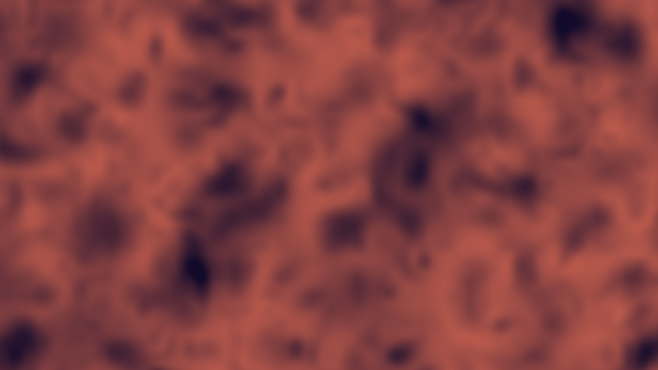

# Fundo abstrato em loop perfeito

**Especificação:** 1920×1080 (ou W×H) · 30 fps · 10 s · loop exato  
**Script verificado:** `$SK/recipes/looping-background.sh` (projeto validado, `expr.errors` = 0, frames inspecionados)

```bash
SK=~/.claude/skills/effectcraft-motion   # rode na pasta de trabalho do usuário, não dentro da skill
W=1920 H=1080 DUR=10 DARK="#120a2a" LIGHT="#ff7a59" $SK/recipes/looping-background.sh lb.ecproj
$SK/scripts/preview.sh lb.ecproj "Loop BG" 6   # contact sheet → inspecione antes do render
```

  
*Frame de referência: t = 2 s.*

## Como funciona
- Solid + Fractal Noise: `fractalType 1` (Turbulent Smooth), `contrast 220`, `brightness -90`, `transform/scale 260`, `complexity 4`.
- Loop: `evolutionOptions/cycleEvolution true`, `cycle 2` e a expressão em `evolution`: `time / thisComp.duration * 360 * effect("Fractal Noise")("Evolution Options")("Cycle (in Revolutions)")`. Com Cycle Evolution, evolution 720 renderiza idêntico a 0 (RMSE 0): o frame em t=duration = frame 0.
- Ajuste do visual: `brightness` muito negativo com contraste baixo satura tudo na cor escura; varie `contrast`/`brightness` e olhe o frame.
- Cor: Tint (`effects/#2/black`, `effects/#2/white` em hex).
- Conferido: primeiro × último frame diferem 0,37% (um passo); primeiro × meio, 17%.
- Qualquer outra animação (offset, escala) precisa voltar ao valor inicial em t=duration.
- Alternativa pronta: `anim.applyBuiltinPreset` com um dos 23 Backgrounds (são "driven by expressions", mas o doc avisa que **não** são loops perfeitos).

**Parâmetros:** `W`, `H`, `DUR`, `DARK`, `LIGHT`. Para GIF, faça a comp pequena (ex.: `W=640 H=360`).

**Lottie:** **Não**: `Noise ▸ Fractal Noise: effect not supported by Lottie (skipped)`; sobra só o solid tingido. Use vídeo ou GIF.

**Render:** GIF (pesa muito): 640×360 × 10 s a 30 fps = 24 MB; `--fps 15` = 12 MB; `--fps 15 --resolution half` (320×180) = 4,2 MB (medidos). Ex.: `W=640 H=360 recipes/looping-background.sh lb.ecproj` e depois `$SK/scripts/render.sh lb.ecproj "Loop BG" lb.gif gif --fps 15`. MP4: `h264`.
