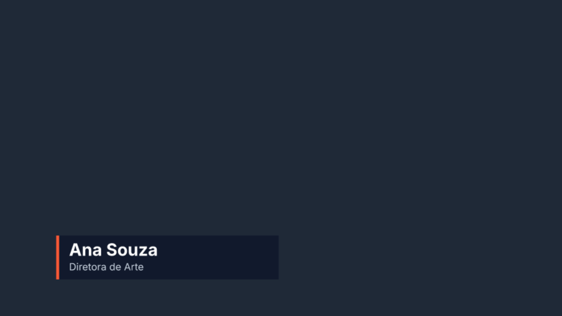

# Lower third (nome + cargo)

**Especificação:** 1920×1080 · 30 fps · 6 s · entrada 0–1 s, hold, saída 5–5,85 s  
**Script verificado:** `$SK/recipes/lower-third.sh` (projeto validado, `expr.errors` = 0, frames inspecionados)

```bash
SK=~/.claude/skills/effectcraft-motion   # rode na pasta de trabalho do usuário, não dentro da skill
NAME="Ana Souza" ROLE="Diretora de Arte" ACCENT="#ff5a36" $SK/recipes/lower-third.sh lt.ecproj
$SK/scripts/preview.sh lt.ecproj "Lower Third" 6   # contact sheet → inspecione antes do render
```

  
*Frame de referência: t = 2 s.*

## Como funciona
- Painel `layer.newShape kind:rect` com `fillOpacity 88`, ancorado na borda esquerda (`transform/anchor [-w/2,0,0]`, `position [x_esq,y,0]`): `scale` X 0→100 cresce da esquerda.
- Barra de destaque (`Accent`) com `scale` Y 0→100.
- Nome e cargo: `layer.newText {font:"Inter", style:"Bold"|"Regular", justify:"left"}`; deslizam 40 px + fade, com 0,15 s de stagger.
- Saída espelhada: textos somem primeiro (5,0–5,4 s), painel recolhe por último (5,3–5,85 s).
- Ease em tudo: `keys.selectAll {layers}` + `keys.easyEase {}` no mesmo `run`.
- Margem title-safe: x=192 (10% de 1920); centro do painel em y=880.

**Parâmetros:** `NAME`, `ROLE`, `ACCENT` (hex). Para outro texto num projeto pronto: `run P layer.setText '{"layer":"Name","text":"…"}' --save` (estilo e animação preservados; testado).

**Lottie:** Sim, sem warnings. Com `textAsShapes:true` a fonte não depende do navegador (ver lottie-web-export).

**Render:** `$SK/scripts/render.sh lt.ecproj "Lower Third" lt.mp4 h264`. Com alpha: remova o fundo (comp sem layer de fundo; a cor de fundo da comp não entra no alpha) e use `prores --prores 4444 --channels rgba`.
