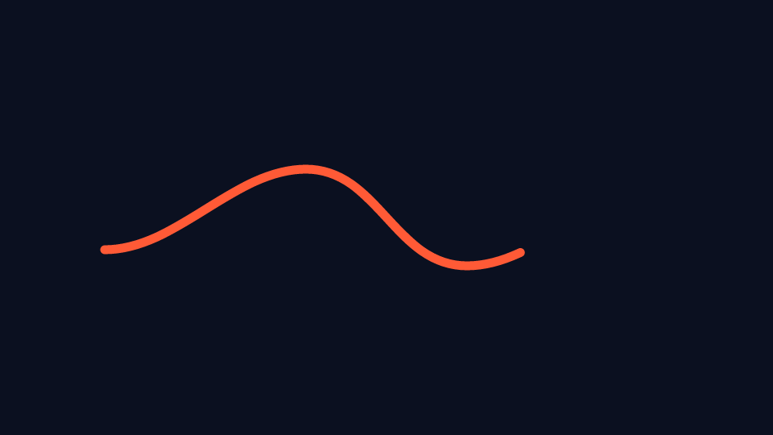

# Shape write-on / write-off

**Especificação:** 1920×1080 · 30 fps · 3 s  
**Script verificado:** `$SK/recipes/shape-write-on.sh` (projeto validado, `expr.errors` = 0, frames inspecionados)

```bash
SK=~/.claude/skills/effectcraft-motion   # rode na pasta de trabalho do usuário, não dentro da skill
COLOR="#ff5a36" $SK/recipes/shape-write-on.sh wo.ecproj
$SK/scripts/preview.sh wo.ecproj "Write On" 6   # contact sheet → inspecione antes do render
```

  
*Frame de referência: t = 0,8 s.*

## Como funciona
- Path livre: `shape.newPath {space:"comp", vertices, inTangents, outTangents, closed:false, fill:false, stroke, strokeWidth}`; tangentes relativas a cada vértice.
- Trim: `layer.addShapeItem kind:trim`; write-on `contents/trim/end` 0→100 (0–1,2 s), write-off `contents/trim/start` 0→100 (1,6–2,7 s).
- `contents/group/contents/stroke/cap 1` e `/join 1` (Round) para pontas suaves.
- Para formas fechadas (círculo, retângulo) use `layer.newShape` e o mesmo trim; `trim/offset` gira o ponto de início.

**Parâmetros:** `COLOR`; troque `vertices`/tangentes para outro traço.

**Lottie:** Sim (path + stroke + trim).

**Render:** `$SK/scripts/render.sh wo.ecproj "Write On" wo.mp4 h264`
