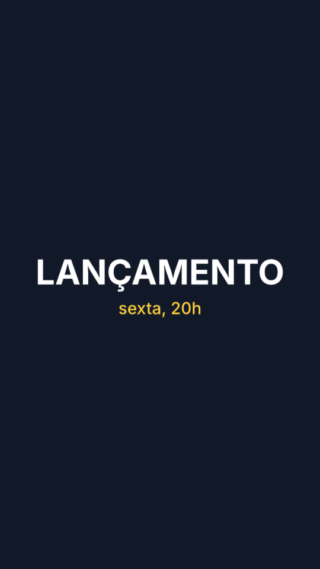

# Revelação de texto letra a letra (vertical 9:16)

**Especificação:** 1080×1920 · 30 fps · 4 s · revelação 0,2–1,6 s  
**Script verificado:** `$SK/recipes/text-reveal-per-character.sh` (projeto validado, `expr.errors` = 0, frames inspecionados)

```bash
SK=~/.claude/skills/effectcraft-motion   # rode na pasta de trabalho do usuário, não dentro da skill
TITLE="LANÇAMENTO" SUB="sexta, 20h" $SK/recipes/text-reveal-per-character.sh tr.ecproj
$SK/scripts/preview.sh tr.ecproj "Reveal" 6   # contact sheet → inspecione antes do render
```

  
*Frame de referência: t = 2,5 s.*

## Como funciona
- `layer.addTextAnimator {layer, properties:["opacity","position","blur"]}` cria o animador com um Range Selector.
- No animador: `properties/opacity 0`, `properties/position [0,80,0]`, `properties/blur [12,12]` (estado "escondido").
- Revelação: `selectors/rangeSelector/start` 0→100 (Easy Ease). As letras saem do selector da esquerda para a direita.
- `advanced/shape` deve ficar em **0 (Square)**. 1 (Ramp Up) deixa letras parcialmente visíveis já em t=0 (testado).
- Safe zone 9:16: texto no terço central (y 960–1100), margens laterais ≥ 8%; nada nos 14% de cima nem nos 20% de baixo (UI das plataformas).
- Por palavra: `advanced/basedOn 2` (Words), testado. Presets prontos: `layer.applyTextPreset {preset:"fadeUpCharacters"|"typewriter"|…}` (keys a partir do CTI).

**Parâmetros:** `TITLE`, `SUB`. Título longo: reduza `size` (116 px cabe 10 caracteres com 12% de margem).

**Lottie:** **Parcial**: a revelação exporta, mas o blur do animador é descartado (`Title ▸ Animator 1 ▸ Blur: text animator property not supported by Lottie`). Para Lottie, use só opacity/position no animador. Com 2+ selectors, só o 1º vai.

**Render:** WebM com alpha: comp sem layer de fundo + `$SK/scripts/render.sh tr.ecproj Reveal tr.webm webm --webm-codec vp9 --channels rgba`.
